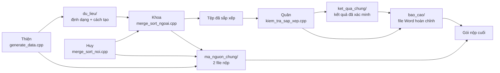

# Hướng dẫn bắt đầu sau khi pull repo

Tài liệu này là điểm bắt đầu duy nhất cho thành viên mới pull repo về. Không cần đọc toàn bộ repo trước khi làm.

## Sau khi pull, làm 5 bước này

1. Mở [README chính](./README.md) để xem yêu cầu và quy tắc nhóm.
2. Mở [bảng tiến độ](./TIEN_DO.md) để biết phần phụ thuộc mình cần đã sẵn sàng hay chưa.
3. Chọn tên mình trong bảng điều hướng bên dưới và đọc `README.md` của workspace cá nhân.
4. Đọc [quy ước tích hợp](./ma_nguon_chung/QUY_UOC_TICH_HOP.md) trước khi viết tham số dòng lệnh hoặc đọc/ghi tệp.
5. Chỉ code trong workspace của mình. Khi hoàn thành, làm theo phần **Quy trình bàn giao** trong tài liệu này.

## Chọn đúng lối đi của bạn

| Thành viên | README phải đọc | Nơi viết code | Nơi viết tài liệu | Nơi tự test | Nơi lưu kết quả |
| --- | --- | --- | --- | --- | --- |
| Quân | [Quan/README.md](./Quan/README.md) | [Quan/ma_nguon/](./Quan/ma_nguon/) | [Quan/tai_lieu/](./Quan/tai_lieu/) | [Quan/kiem_thu/](./Quan/kiem_thu/) | [Quan/ket_qua/](./Quan/ket_qua/) |
| Huy | [Huy/README.md](./Huy/README.md) | [Huy/ma_nguon/](./Huy/ma_nguon/) | [Huy/tai_lieu/](./Huy/tai_lieu/) | [Huy/kiem_thu/](./Huy/kiem_thu/) | [Huy/ket_qua/](./Huy/ket_qua/) |
| Thiện | [Thien/README.md](./Thien/README.md) | [Thien/ma_nguon/](./Thien/ma_nguon/) | [Thien/tai_lieu/](./Thien/tai_lieu/) | [Thien/kiem_thu/](./Thien/kiem_thu/) | [Thien/ket_qua/](./Thien/ket_qua/) |
| Khoa | [Khoa/README.md](./Khoa/README.md) | [Khoa/ma_nguon/](./Khoa/ma_nguon/) | [Khoa/tai_lieu/](./Khoa/tai_lieu/) | [Khoa/kiem_thu/](./Khoa/kiem_thu/) | [Khoa/ket_qua/](./Khoa/ket_qua/) |

## Luồng phụ thuộc và bàn giao

## Mỗi đường dẫn được dùng để làm gì?

| Đường dẫn | Ai quản lý | Dùng để | Không dùng để |
| --- | --- | --- | --- |
| [`Quan/`](./Quan/) | Quân | Viết verifier, lý thuyết, test tích hợp và benchmark | Chứa bản chính thức của cả nhóm |
| [`Huy/`](./Huy/) | Huy | Viết Merge Sort nội và test thuật toán | Viết Merge Sort ngoại |
| [`Thien/`](./Thien/) | Thiện | Viết bộ sinh dữ liệu và test I/O | Commit tệp dữ liệu lớn |
| [`Khoa/`](./Khoa/) | Khoa | Viết Merge Sort ngoại và tích hợp | Sửa trực tiếp workspace của Huy/Thiện |
| [`ma_nguon_chung/`](./ma_nguon_chung/) | Khoa, Huy, Quân | Chứa đúng 2 file mã nguồn đã duyệt để nộp | Phát triển bản nháp |
| [`du_lieu/`](./du_lieu/) | Thiện | Mô tả định dạng, cách sinh và lệnh tạo dữ liệu | Lưu tệp `.bin` 30–50 triệu phần tử trên Git |
| [`kiem_thu/`](./kiem_thu/) | Quân | Chứa verifier và bộ test tích hợp đã duyệt | Chứa mã sắp xếp chính |
| [`ket_qua_chung/`](./ket_qua_chung/) | Quân, Khoa | Chứa log, CSV/bảng benchmark và kết quả đã xác minh | Lưu tệp nhị phân lớn |
| [`bao_cao/`](./bao_cao/) | Quân | Chứa file Word và tài nguyên dùng trong báo cáo | Chứa bản nháp cá nhân chưa duyệt |

## Từ workspace cá nhân đến sản phẩm chung

| Sản phẩm | Nơi làm việc | Người nhận bàn giao | Đích đến sau khi duyệt |
| --- | --- | --- | --- |
| Bộ sinh dữ liệu | [`Thien/ma_nguon/generate_data.cpp`](./Thien/ma_nguon/) | Khoa kiểm tra khả năng đọc | `ma_nguon_chung/Nhom06_BT03_GenerateData.cpp` |
| Merge Sort nội | [`Huy/ma_nguon/merge_sort_noi.cpp`](./Huy/ma_nguon/) | Khoa tích hợp | Gộp vào `ma_nguon_chung/Nhom06_BT03_MergeSort.cpp` |
| Merge Sort ngoại | [`Khoa/ma_nguon/merge_sort_ngoai.cpp`](./Khoa/ma_nguon/) | Quân xác minh, Huy duyệt thuật toán | `ma_nguon_chung/Nhom06_BT03_MergeSort.cpp` |
| Công cụ xác minh | [`Quan/ma_nguon/kiem_tra_sap_xep.cpp`](./Quan/ma_nguon/) | Khoa chạy chéo | `kiem_thu/kiem_tra_sap_xep.cpp`, không thuộc 2 file nộp |
| Lý thuyết báo cáo | [`Quan/tai_lieu/`](./Quan/tai_lieu/) và `tai_lieu/` của mỗi người | Quân tổng hợp | [`bao_cao/`](./bao_cao/) |
| Kết quả benchmark | [`Quan/ket_qua/`](./Quan/ket_qua/) và [`Khoa/ket_qua/`](./Khoa/ket_qua/) | Quân xác minh | [`ket_qua_chung/`](./ket_qua_chung/) |

## Ai có thể bắt đầu ngay?

- **Huy:** có thể viết Merge Sort nội và test ngay; chỉ cần chốt giao diện hàm với Khoa trước khi bàn giao.
- **Thiện:** có thể viết bộ sinh ngay theo quy ước; chốt định dạng tệp với Khoa.
- **Khoa:** có thể tạo khung I/O, run và tệp tạm ngay; tích hợp hàm của Huy sau khi được bàn giao.
- **Quân:** có thể viết verifier và phần lý thuyết ngay; chạy tích hợp sau khi Khoa bàn giao tệp đầu ra.

## Quy trình bàn giao

1. Hoàn thành code trong `ma_nguon/` cá nhân.
2. Lưu test trong `kiem_thu/` cá nhân và kết quả trong `ket_qua/` cá nhân.
3. Cập nhật dòng tương ứng trong [TIEN_DO.md](./TIEN_DO.md) thành **Chờ duyệt**.
4. Người nhận bàn giao pull code, chạy lại test và ghi nhận kết quả.
5. Nếu đạt, chính tác giả hoặc người tích hợp chuyển bản đã duyệt sang thư mục chung.
6. Cập nhật trạng thái thành **Hoàn thành** và ghi rõ đường dẫn sản phẩm chung.

## Bốn điều không được làm

- Không code trực tiếp trong `ma_nguon_chung/`.
- Không sửa workspace của người khác khi chưa trao đổi.
- Không commit file `.bin`, `.dat`, `.tmp`, file biên dịch hoặc run tạm.
- Không dùng kết quả benchmark trong báo cáo nếu chưa được Quân xác minh.
